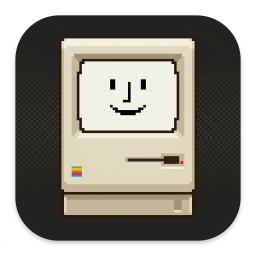

<p align="center">
  
</p>

<h1 align="center">Hello '84（你好 84 · <code>dsh-hello84</code>）</h1>

<p align="center">
  在 DeepSeek Harness（DSH）窗口角落养一台活着的 1984 复古 Macintosh。<br>
  <strong>不绑定任何主题</strong>（Shadow DOM 严格样式隔离）· 零原生依赖 · Windows / macOS / Linux 开箱即用
</p>

---

## 核心特性

- **1984 Macintosh 128K 机身与 3 套屏幕模式**
  - 默认经典 **Classic 1-bit** 黑白像素（System 6/7 质感），一键切换 **CRT Green（荧光绿屏）** / **CRT Amber（琥珀屏）**。
  - 首次展开播放致敬初代 Mac 的手写体 `hello.` 开机仪式（可跳过/关闭），内置 Web Audio 合成复古提示音（默认静音，一键开关）。
- **活体迷你待机态与边缘吸附**
  - 角落可拖拽的迷你像素小 Mac，拖近屏幕左右边缘自动贴边收起，不遮挡聊天区与发送按钮。
  - 待机态自动轮播 1984 经典微屏（**Happy Mac** / **飞翔烤面包机** / **像素星海** / **实时像素时钟**）；干活时实时映射外部宿主 DSH 状态（转手表 / 滚动代码条 / 软驱红灯狂闪 / 待审批 Happy Mac 跳动 / 出错 Sad Mac `0F0064`）。
- **InnerLife（内心剧场 & 主动冒泡）**
  - 借鉴 ClaraCore InnerLife 的克制设计：静默观察外部 DSH 的任务收尾、报错、卡审批、长草稿停顿与 Note Pad 新记录。
  - **零配置**走确定性本地启发；配 Key 后（默认 `deepseek-flash`）在空闲窗口后台自主琢磨，并弹出 **1-bit 复古思绪气泡**，支持一键「填入主框 / 副脑深聊 / 存便签 / 忽略」。
  - 内置 `[NO_SHARE]` 哨兵、中文分词 Token 相似度去重、候选池上限（8 条 / 7 天过期）、冷却与每日上限，支持切换 3 种性格（犀利搭档 / 冷静观察 / 84 极客）。
- **8 款内置 1-bit 复古桌面应用**
  1. **Mini DSH（双模套娃客户端）**：
     - *零配置模式*：同步外部 DSH 会话列表与状态，点击直切主会话，终端直接填入/发送外部输入框。
     - *配 Key 模式*：支持 DeepSeek / 任意 OpenAI 兼容接口独立旁路对话（不污染主会话），一键抓取外部草稿或最近回复进行「润色 / 挑刺 / 翻译 / 总结」，支持调用本地工具（`write_note`、`set_alarm`、`fill_host_draft`）。
  2. **InnerLife（内心剧场）**：管理自动琢磨开关、性格、待说思绪池与琢磨日志。
  3. **Terminal（1984 复古命令行）**：反色像素终端，纯键盘操控 DSH 与小 Mac，支持 `↑/↓` 历史命令。
  4. **Note Pad（经典翻页便签）**：左下角折角翻页，`localStorage` 持久化，一键注入外部 DSH 输入框。
  5. **Floppy Disk（3.5 寸软盘导出）**：一键导出当前会话为 Markdown，或渲染成 **1984 Macintosh 窗口风格 PNG 分享长图**（默认自动脱敏本机路径）。
  6. **Alarm Clock（复古闹钟）**：番茄钟 / 自定义倒计时 + 外部任务跑完 / 卡审批 / 出错时复古提示音提醒。
  7. **MacPaint Lite**：1-bit 像素画板（画笔 / 喷枪 / 橡皮 / 存 PNG）。
  8. **Minesweeper**：经典 9×9 扫雷（首击必安全，左键翻开、右键插旗）。

---

## Terminal 快捷指令速查

| 指令 | 说明 |
| --- | --- |
| `status` | 查看外部 DSH 会话状态与 InnerLife 运行概况 |
| `ls [sessions\|notes\|thoughts\|apps]` | 列出外部会话、便签页、InnerLife 思绪或桌面应用 |
| `cd <编号\|关键词>` | 切换外部 DSH 主会话 |
| `open <app>` | 打开小 Mac 应用（如 `open notepad` / `open mines`） |
| `draft <文本>` / `send <文本>` | 填入外部输入框 / 直接发给外部 DSH |
| `ask <问题>` | 在终端内直连旁路副脑（需配 Key，支持工具调用） |
| `think` | 立即触发一次 InnerLife 琢磨 |
| `note <内容>` | 记一条新便签到 Note Pad |
| `alarm <分钟> [标签]` | 启动复古闹钟（`alarm reset` 重置） |
| `mode <classic\|green\|amber>` | 切换 CRT 屏幕模式 |
| `sound <on\|off>` | 开关复古提示音 |
| `export` | 脱敏导出当前会话 Markdown 并尝试复制 |
| `hello` / `clear` | 1984 Macintosh ASCII 彩蛋 / 清屏 |

---

## 旁路副脑与 CORS 说明

- 在 **Mini DSH → 旁路副脑 → `⚙ API`** 中填写 `API Key` 即可启用模型能力（默认 Base URL 为 `https://api.deepseek.com/v1`，默认模型 `deepseek-flash`，兼容任意 OpenAI 协议接口）。
- 若目标接口未开放浏览器 CORS，可在 `Proxy` 栏填写代理地址；当宿主 DSH 服务端支持插件路由时，[index.js](./index.js) 会自动挂载零依赖本地代理 `/hello84/proxy`。

---

## 开发与验证

```bash
npm install
npm run build      # 生成单文件 lib/client.js（内联 CSS，零外链）
npm run preview    # 生成离线交互预览 dist/preview.html
npm test           # 运行构建与全部单元测试（node --test + jsdom）
```

## 许可证

[MIT](./LICENSE)
